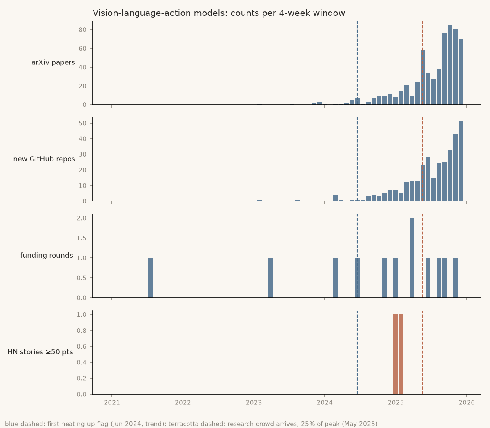

# BleedingEdge

A personal research radar: it looks for AI research topics that are heating up before everyone else notices, and backtests the method on 2021–25 history before trusting it.

**Status:** only the backtest is built, and it **fails**. It flags known topics 16–48 weeks early, but just 6% of its 2024 flags turned into real trends (the bar is 50%). See [why](docs/BACKTEST.md).

*Vision-language-action models, 2021–25. Blue dashed line: BleedingEdge's first flag (Jun 2024). Red dashed line: the research crowd arrives (May 2025).*

## Links

- **Run it:** [Setup and instructions](docs/INSTRUCTIONS.md) (one `uv run` command; the first run fetches about 2 hours of data, then re-runs are free)
- **Results:** [What the backtest found](docs/BACKTEST.md) · [Every count, query and chart](docs/BacktestResults.md)
- **How it works:** [System design](docs/SYSTEM-DESIGN.md) · [What's where](docs/FILE-STRUCTURE.md)
- **The spec:** [BleedingEdge.md](BleedingEdge.md)
