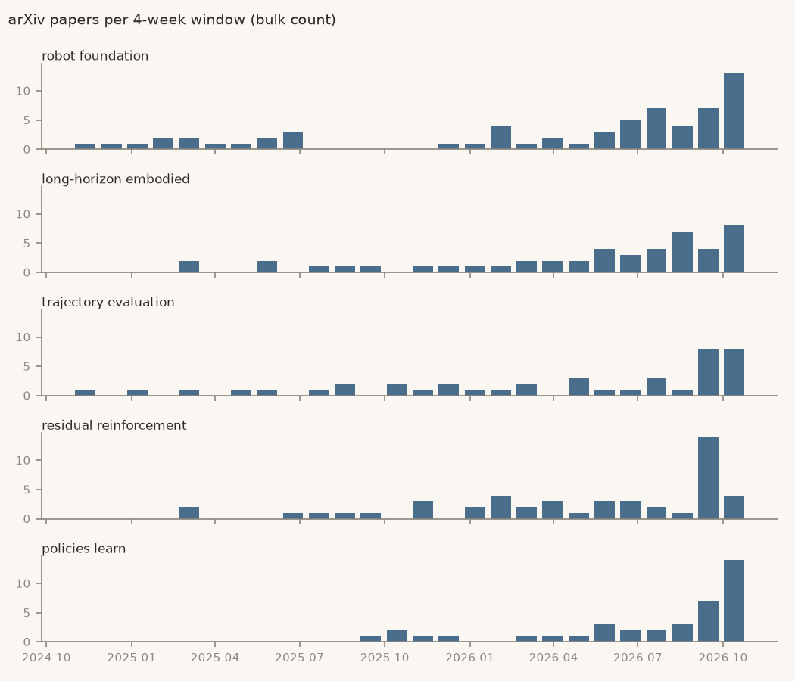

# Robotics brief, 27 Oct 2026

Week 1 of 4 of the trial. Robotics only (phrases from cs.RO titles).

> **Track record, read first.** In a backtest on robotics phrases new in 2024, **1 of 19 flagged topics (5%) took off within a year**. Picking at random would have found 6 of 491 (1%). It caught 1 of the 6 that took off. That failed the 50% bar set before testing. This trial runs on a bar lowered after seeing that result, so treat every flag below as roughly a 1-in-19 bet. [Details](../docs/BACKTEST.md#round-2-results)

## Study this next

<!-- pick:start -->
**Pick: robot foundation models, studied from the inside.**

**What it is.** "Robot foundation models" are large pretrained policies, mostly vision-language-action (VLA) models, adapted to new robot tasks. The fresh angle this week is opening them up: tracing which layers turn an image and an instruction into a movement, then using that map to make the model cheaper.

**Why now.** Score 3.65, the top early topic. Against a year ago, papers are up 16.3× (relative to arXiv's own growth) and new repos 8.5× (raw GitHub count). There were 24 papers and 33 new repos in the last 12 weeks. First flagged in the window ending 1 Sep 2026.

**What it rests on.**
- [Causal Analysis of Robot Foundation Models Enables Efficiency Gains](https://arxiv.org/abs/2610.20750). It applies activation patching to π0.5, MolmoAct2 and MolmoBot and finds a narrow band of cross-attention layers carrying the instruction into the action expert. Conditioning on 3 of 36 layers cut inference FLOPs by up to 33% at 46.7% vs 46.9% task success.
- [Sensorimotor Alignment](https://arxiv.org/abs/2610.31670): ranking these models offline, before robot trials.
- [Training in Deployment](https://arxiv.org/abs/2610.29264): updating them online from human interventions.

**What would prove it wrong.** Its 12-week paper count (bulk) never passes 96, four times today's 24, by 27 Oct 2027. If so, the crowd had already arrived when it was flagged.

**First step, about 2 hours.** Work through [arXiv 2610.20750](https://arxiv.org/abs/2610.20750) with researcher-pal. By the end, you should be able to explain activation patching, and why so few layers are enough to condition the action expert.
<!-- pick:end -->

## Early / speculative

Confidence for every row: **low** (see the track record above). Score = weighted log₂ growth of papers and new repos (1 = doubling). Paper ratios are relative to arXiv's own growth; repo ratios are raw GitHub counts.

| Topic | Score | Why flagged | Papers, 12 wk | New repos, 12 wk | First flagged (window ending) |
|---|---|---|---|---|---|
| **robot foundation** | 3.65 | trend: papers 16.3×, new repos 8.5× vs a year ago | [24](https://arxiv.org/search/?query=%22robot+foundation%22&searchtype=all) | [33](https://github.com/search?q=%22robot+foundation%22+in%3Aname%2Cdescription+created%3A2026-08-04..2026-10-26&type=repositories) | 2026-09-01 |
| **long-horizon embodied** | 2.66 | trend: papers 4.4×, new repos 11.0× vs a year ago | [19](https://arxiv.org/search/?query=%22long-horizon+embodied%22&searchtype=all) | [10](https://github.com/search?q=%22long-horizon+embodied%22+in%3Aname%2Cdescription+created%3A2026-08-04..2026-10-26&type=repositories) | 2026-09-29 |
| **trajectory evaluation** | 2.61 | trend: papers 2.3×, new repos 25.5× vs a year ago | [17](https://arxiv.org/search/?query=%22trajectory+evaluation%22&searchtype=all) | [50](https://github.com/search?q=%22trajectory+evaluation%22+in%3Aname%2Cdescription+created%3A2026-08-04..2026-10-26&type=repositories) | 2026-08-04 |
| **residual reinforcement** | 2.40 | trend: papers 4.4×, new repos 7.0× vs a year ago | [19](https://arxiv.org/search/?query=%22residual+reinforcement%22&searchtype=all) | [13](https://github.com/search?q=%22residual+reinforcement%22+in%3Aname%2Cdescription+created%3A2026-08-04..2026-10-26&type=repositories) | 2026-09-29 |
| **policies learn** | 2.34 | trend: papers 4.1×, new repos 7.0× vs a year ago | [24](https://arxiv.org/search/?query=%22policies+learn%22&searchtype=all) | [6](https://github.com/search?q=%22policies+learn%22+in%3Aname%2Cdescription+created%3A2026-08-04..2026-10-26&type=repositories) | 2026-09-29 |

## Consensus is moving

Heating up with 30 or more papers in 12 weeks: no longer early.

| Topic | Score | Why flagged | Papers, 12 wk | New repos, 12 wk | First flagged (window ending) |
|---|---|---|---|---|---|
| **latent world** | 4.95 | trend: papers 17.5×, new repos 73.0× vs a year ago | [106](https://arxiv.org/search/?query=%22latent+world%22&searchtype=all) | [72](https://github.com/search?q=%22latent+world%22+in%3Aname%2Cdescription+created%3A2026-08-04..2026-10-26&type=repositories) | 2025-12-23 |
| **video world** | 4.07 | trend: papers 16.3×, new repos 17.6× vs a year ago | [49](https://arxiv.org/search/?query=%22video+world%22&searchtype=all) | [87](https://github.com/search?q=%22video+world%22+in%3Aname%2Cdescription+created%3A2026-08-04..2026-10-26&type=repositories) | 2025-12-23 |
| **physical ai** | 3.64 | trend: papers 8.3×, new repos 22.7× vs a year ago | [50](https://arxiv.org/search/?query=%22physical+ai%22&searchtype=all) | [1088](https://github.com/search?q=%22physical+ai%22+in%3Aname%2Cdescription+created%3A2026-08-04..2026-10-26&type=repositories) | 2025-08-05 |
| **action chunks** | 3.39 | trend: papers 10.7×, new repos 10.2× vs a year ago | [114](https://arxiv.org/search/?query=%22action+chunks%22&searchtype=all) | [60](https://github.com/search?q=%22action+chunks%22+in%3Aname%2Cdescription+created%3A2026-08-04..2026-10-26&type=repositories) | 2025-12-23 |
| **humanoid loco-manipulation** | 2.24 | burst: papers 3.0×, new repos 5.0× vs the 12 weeks before | [46](https://arxiv.org/search/?query=%22humanoid+loco-manipulation%22&searchtype=all) | [20](https://github.com/search?q=%22humanoid+loco-manipulation%22+in%3Aname%2Cdescription+created%3A2026-08-04..2026-10-26&type=repositories) | 2026-07-07 |

## Not covered in this trial

Tools rising and fading, companies heating up, AI tooling and the wider field. Across all four categories the method scored about random in the backtest (on held-out phrases, 1 of 14 flagged topics took off, 7%, against 6% at random), so this trial leaves them out rather than print flags known to be noise.

## How this was made

- Candidates: 578 two- and three-word phrases in cs.RO titles in 2025 that were rare in the two years before (`bleedingedge/mining.py`). Mined by rule, not picked.
- Paper counts: arXiv bulk metadata (cs.RO, cs.LG, cs.AI, cs.CL; title or abstract) to 26 Oct 2026. The linked arXiv searches count differently (the bulk count is about 0.6× arXiv search); they are there to read the papers. The newest days are thin because arXiv announces papers a day or two late.
- New repos: GitHub repository search on name and description, linked per row.
- Thresholds are invented starting points, unchanged from the backtest. Every row is in `data/Trends.csv`.
- No buy, sell or hold advice, ever.
