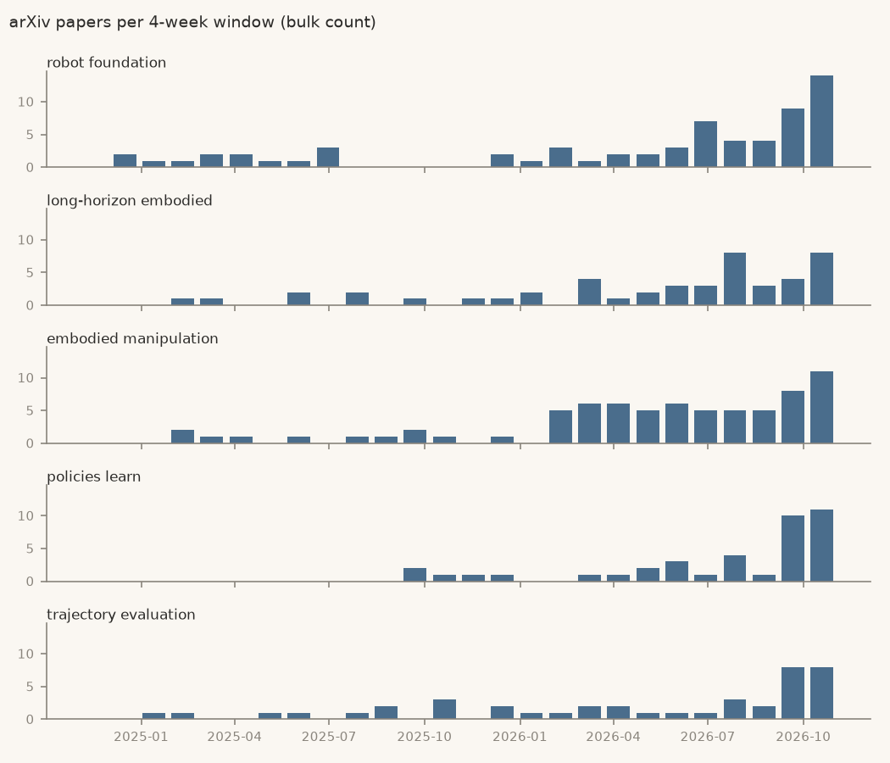

# Robotics brief, 2 Nov 2026

Week 2 of 4 of the trial. Robotics only (phrases from cs.RO titles).

> **Track record, read first.** In a backtest on robotics phrases new in 2024, **1 of 19 flagged topics (5%) took off within a year**. Picking at random would have found 6 of 491 (1%). It caught 1 of the 6 that took off. That failed the 50% bar set before testing. This trial runs on a bar lowered after seeing that result, so treat every flag below as roughly a 1-in-19 bet. [Details](../docs/BACKTEST.md#round-2-results)

## Study this next

<!-- pick:start -->
**Pick: long-horizon embodied agents, tested in a world that keeps changing.**

**What it is.** These are robot agents that pursue a goal over many steps while the scene, the task or the people around them change. The research question is whether a language model driving a simulated robot can recover from those changes, not just finish a fixed plan. The phrase is an adjective pair, but all three papers below use it for this one problem.

**Why now.** Score 2.42, the top early topic after last week's pick. Against a year ago, papers are up 5.2× (relative to arXiv's own growth) and new repos 5.5× (raw GitHub count). There were 15 papers and 10 new repos in the last 12 weeks.

**What it rests on.**
- [TARSphere](https://arxiv.org/abs/2610.30043): a benchmark of 360 episodes across 30 indoor scenes. Among 8 models, general-purpose ones can beat embodied ones, while task updates and human interaction stay hard.
- [Preemptive Instruction Following with Resumption](https://arxiv.org/abs/2610.35576): a benchmark for interrupting a navigation task and resuming it.
- [CausGround](https://arxiv.org/abs/2610.29702): reusable action preconditions and effects for planning, without parameter updates.

**What would prove it wrong.** Its 12-week paper count (bulk) never passes 60, four times today's 15, by 2 Nov 2027.

**First step, about 2 hours.** Work through [arXiv 2610.30043](https://arxiv.org/abs/2610.30043) with researcher-pal. By the end, you should be able to explain how its event-driven state machine scores a task that changes midway. Reading only: [its code](https://github.com/xuyicheng-zju/TARSphere) targets Ubuntu, an RTX 4090 and Isaac Sim 5.1.
<!-- pick:end -->

## Opportunities to apply to

<!-- opportunities:start -->
- **Fellowship:** [RobotX PhD Fellowship 2027, ETH Zurich](https://jobs.ethz.ch/job/view/JOPG_ethz_zBtPwWHnM0fumyTFso). Deadline 27 Nov 2026. Fits: reinforcement learning and legged or manipulation groups, with one application reviewed by up to three professors. Check: needs a Master's completed by Aug 2027, and three references. Checked 2 Nov 2026.
- **Fellowship:** [Anthropic Fellows Program, Reinforcement Learning track](https://job-boards.greenhouse.io/anthropic/jobs/5183051008). Rolling, next cohort expected Jan 2027. Fits: 4 months building RL environments, including for safety-related tasks. Check: needs work authorization in the US, UK or Canada, with no visa sponsorship. Checked 2 Nov 2026.
- **Job:** [Reinforcement Learning Engineer, Whole Body Control, Figure](https://job-boards.greenhouse.io/figureai/jobs/4671442006). Rolling, San Jose. Fits: RL for humanoid control and closing sim-to-real gaps. Check: asks for a strong dynamics and control background and for leading complex projects; the page states no degree or citizenship requirement, so ask about work authorization. Checked 2 Nov 2026.
<!-- opportunities:end -->

## Early / speculative

Confidence for every row: **low** (see the track record above). Score = weighted log₂ growth of papers and new repos (1 = doubling). Paper ratios are relative to arXiv's own growth; repo ratios are raw GitHub counts.

| Topic | Score | Why flagged | Papers, 12 wk | New repos, 12 wk | First flagged (window ending) |
|---|---|---|---|---|---|
| **robot foundation** | 3.79 | trend: papers 18.4×, new repos 9.0× vs a year ago | [27](https://arxiv.org/search/?query=%22robot+foundation%22&searchtype=all) | [35](https://github.com/search?q=%22robot+foundation%22+in%3Aname%2Cdescription+created%3A2026-08-10..2026-11-01&type=repositories) | 2026-08-10 |
| **long-horizon embodied** | 2.42 | trend: papers 5.2×, new repos 5.5× vs a year ago | [15](https://arxiv.org/search/?query=%22long-horizon+embodied%22&searchtype=all) | [10](https://github.com/search?q=%22long-horizon+embodied%22+in%3Aname%2Cdescription+created%3A2026-08-10..2026-11-01&type=repositories) | 2026-10-05 |
| **embodied manipulation** | 2.41 | trend: papers 3.3×, new repos 11.0× vs a year ago | [24](https://arxiv.org/search/?query=%22embodied+manipulation%22&searchtype=all) | [10](https://github.com/search?q=%22embodied+manipulation%22+in%3Aname%2Cdescription+created%3A2026-08-10..2026-11-01&type=repositories) | 2026-05-18 |
| **policies learn** | 2.27 | trend: papers 3.8×, new repos 7.0× vs a year ago | [22](https://arxiv.org/search/?query=%22policies+learn%22&searchtype=all) | [6](https://github.com/search?q=%22policies+learn%22+in%3Aname%2Cdescription+created%3A2026-08-10..2026-11-01&type=repositories) | 2026-10-05 |
| **trajectory evaluation** | 2.26 | trend: papers 2.1×, new repos 16.7× vs a year ago | [18](https://arxiv.org/search/?query=%22trajectory+evaluation%22&searchtype=all) | [49](https://github.com/search?q=%22trajectory+evaluation%22+in%3Aname%2Cdescription+created%3A2026-08-10..2026-11-01&type=repositories) | 2026-08-10 |

## Consensus is moving

Heating up with 30 or more papers in 12 weeks: no longer early.

| Topic | Score | Why flagged | Papers, 12 wk | New repos, 12 wk | First flagged (window ending) |
|---|---|---|---|---|---|
| **latent world** | 4.96 | trend: papers 18.0×, new repos 71.0× vs a year ago | [109](https://arxiv.org/search/?query=%22latent+world%22&searchtype=all) | [70](https://github.com/search?q=%22latent+world%22+in%3Aname%2Cdescription+created%3A2026-08-10..2026-11-01&type=repositories) | 2025-12-29 |
| **video world** | 4.11 | trend: papers 17.1×, new repos 17.6× vs a year ago | [51](https://arxiv.org/search/?query=%22video+world%22&searchtype=all) | [87](https://github.com/search?q=%22video+world%22+in%3Aname%2Cdescription+created%3A2026-08-10..2026-11-01&type=repositories) | 2026-01-26 |
| **physical ai** | 3.35 | trend: papers 5.2×, new repos 27.7× vs a year ago | [47](https://arxiv.org/search/?query=%22physical+ai%22&searchtype=all) | [1357](https://github.com/search?q=%22physical+ai%22+in%3Aname%2Cdescription+created%3A2026-08-10..2026-11-01&type=repositories) | 2025-09-08 |
| **action chunks** | 3.32 | trend: papers 9.4×, new repos 10.8× vs a year ago | [114](https://arxiv.org/search/?query=%22action+chunks%22&searchtype=all) | [64](https://github.com/search?q=%22action+chunks%22+in%3Aname%2Cdescription+created%3A2026-08-10..2026-11-01&type=repositories) | 2025-12-29 |
| **humanoid loco-manipulation** | 2.14 | burst: papers 1.8×, new repos 3.0× vs the 12 weeks before | [44](https://arxiv.org/search/?query=%22humanoid+loco-manipulation%22&searchtype=all) | [22](https://github.com/search?q=%22humanoid+loco-manipulation%22+in%3Aname%2Cdescription+created%3A2026-08-10..2026-11-01&type=repositories) | 2026-08-10 |

## Not covered in this trial

Tools rising and fading, companies heating up, AI tooling and the wider field. Across all four categories the method scored about random in the backtest (on held-out phrases, 1 of 14 flagged topics took off, 7%, against 6% at random), so this trial leaves them out rather than print flags known to be noise.

## How this was made

- Candidates: 578 two- and three-word phrases in cs.RO titles in 2025 that were rare in the two years before (`bleedingedge/mining.py`). Mined by rule, not picked.
- Paper counts: arXiv bulk metadata (cs.RO, cs.LG, cs.AI, cs.CL; title or abstract) to 1 Nov 2026. The linked arXiv searches count differently (the bulk count is about 0.6× arXiv search); they are there to read the papers. The newest days are thin because arXiv announces papers a day or two late.
- New repos: GitHub repository search on name and description, linked per row.
- Thresholds are invented starting points, unchanged from the backtest. Every row is in `data/Trends.csv`.
- No buy, sell or hold advice, ever.
