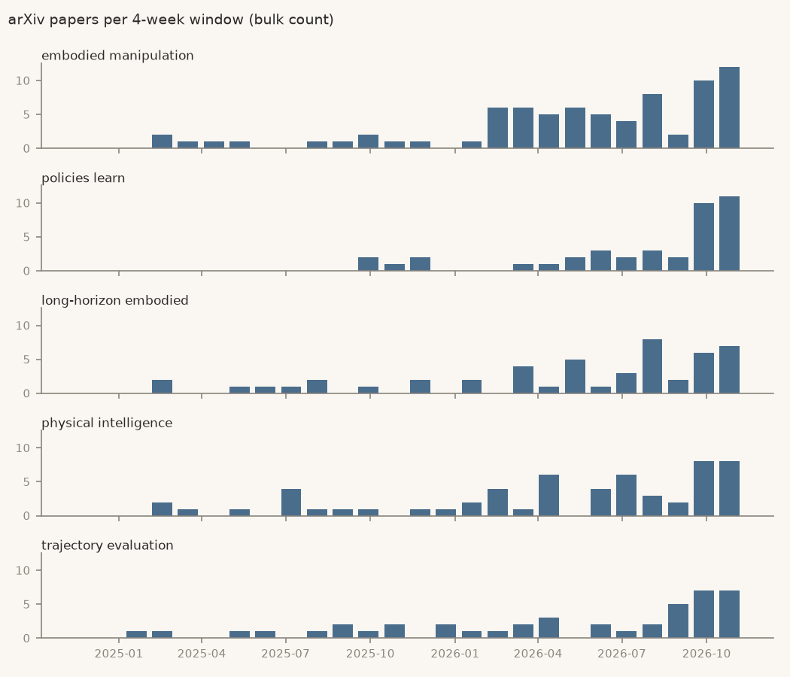

# Robotics brief, 9 Nov 2026

Week 3 of 4 of the trial. Robotics only (phrases from cs.RO titles).

> **Track record, read first.** In a backtest on robotics phrases new in 2024, **1 of 19 flagged topics (5%) took off within a year**. Picking at random would have found 6 of 491 (1%). It caught 1 of the 6 that took off. That failed the 50% bar set before testing. This trial runs on a bar lowered after seeing that result, so treat every flag below as roughly a 1-in-19 bet. [Details](../docs/BACKTEST.md#round-2-results)

## Study this next

<!-- pick:start -->
**Pick: embodied manipulation, where a model plans and acts on objects through a robot body.**

**What it is.** Robots that pick up, place and use objects, with a vision-language model reasoning about the scene and driving the arms. It is a broad label: the three papers below tackle where to grasp, planning with tools, and using context over time. ("policies learn", next down, is a fragment, so skipped.)

**Why now.** Score 2.50, the top early topic this week (3rd last week). Against a year ago, papers are up 3.2× (relative to arXiv's own growth) and new repos 13.0× (raw GitHub count). There were 24 papers and 12 new repos in the last 12 weeks.

**What it rests on.**
- [Auriga](https://arxiv.org/abs/2611.01112): an agent harness that previews trajectories and stops on divergence; 57.7% success on RoboDojo, double the reference harness.
- [AffordJEV](https://arxiv.org/abs/2611.07896): picks which object part does a requested action without chain-of-thought text.
- [PRIME W0](https://arxiv.org/abs/2610.39528): a vision-language-action model with world-model subgoals and history.

**What would prove it wrong.** Its 12-week paper count (bulk) never passes 96, four times today's 24, by 9 Nov 2027.

**First step, about 2 hours.** Work through [arXiv 2611.01112](https://arxiv.org/abs/2611.01112) with researcher-pal. By the end, explain how its single execution gateway checks stage tolerances and hands failures back to the model. Reading only: [its code](https://github.com/lose4578/Auriga) needs Linux, an NVIDIA GPU with Isaac Sim 5.1 and a paid model API.
<!-- pick:end -->

## Opportunities to apply to

<!-- opportunities:start -->
- **Job:** [Senior Reinforcement Learning Engineer, ANYbotics](https://jobs.lever.co/anybotics/63f0c6db-0a1f-4a4a-87dd-9a43c9c2bdd2). Rolling, Zurich (hybrid). Fits: owns the RL training and sim-to-real pipeline for ANYmal legged robots, including domain randomisation and reward shaping. Check: asks for a PhD with a strong RL focus, or an equivalent RL track record in robotics, or a Master's plus 5+ years; the page states no citizenship or work-permit requirement, so ask. Checked 9 Nov 2026.
- **Job:** [Post-Training Applied Researcher, Baseten](https://jobs.ashbyhq.com/baseten/2d18b2aa-b6fc-4f1c-8936-33b03255a090). Rolling, San Francisco. Fits: builds reward functions and RL environments for LLM post-training, and diagnoses reward hacking in training runs. Check: asks for hands-on GRPO or PPO training of LLMs and multi-turn agent environments; the page states no degree, citizenship or visa terms, so ask. Checked 9 Nov 2026.

Only 2 this week. Other leads (1X, Flexion, Echo Neurotechnologies, Paradromics, a Michigan postdoc) could not be confirmed open on an official page.
<!-- opportunities:end -->

## Early / speculative

Confidence for every row: **low** (see the track record above). Score = weighted log₂ growth of papers and new repos (1 = doubling). Paper ratios are relative to arXiv's own growth; repo ratios are raw GitHub counts.

| Topic | Score | Why flagged | Papers, 12 wk | New repos, 12 wk | First flagged (window ending) |
|---|---|---|---|---|---|
| **embodied manipulation** | 2.50 | trend: papers 3.2×, new repos 13.0× vs a year ago | [24](https://arxiv.org/search/?query=%22embodied+manipulation%22&searchtype=all) | [12](https://github.com/search?q=%22embodied+manipulation%22+in%3Aname%2Cdescription+created%3A2026-08-17..2026-11-08&type=repositories) | 2026-04-27 |
| **policies learn** | 2.38 | trend: papers 3.9×, new repos 8.0× vs a year ago | [23](https://arxiv.org/search/?query=%22policies+learn%22&searchtype=all) | [7](https://github.com/search?q=%22policies+learn%22+in%3Aname%2Cdescription+created%3A2026-08-17..2026-11-08&type=repositories) | 2026-10-12 |
| **long-horizon embodied** | 2.35 | trend: papers 5.2×, new repos 5.0× vs a year ago | [15](https://arxiv.org/search/?query=%22long-horizon+embodied%22&searchtype=all) | [9](https://github.com/search?q=%22long-horizon+embodied%22+in%3Aname%2Cdescription+created%3A2026-08-17..2026-11-08&type=repositories) | 2026-05-25 |
| **physical intelligence** | 2.24 | trend: papers 4.1×, new repos 5.9× vs a year ago | [18](https://arxiv.org/search/?query=%22physical+intelligence%22&searchtype=all) | [46](https://github.com/search?q=%22physical+intelligence%22+in%3Aname%2Cdescription+created%3A2026-08-17..2026-11-08&type=repositories) | 2026-04-27 |
| **trajectory evaluation** | 2.23 | trend: papers 2.2×, new repos 15.0× vs a year ago | [19](https://arxiv.org/search/?query=%22trajectory+evaluation%22&searchtype=all) | [44](https://github.com/search?q=%22trajectory+evaluation%22+in%3Aname%2Cdescription+created%3A2026-08-17..2026-11-08&type=repositories) | 2026-10-12 |

## Consensus is moving

Heating up with 30 or more papers in 12 weeks: no longer early.

| Topic | Score | Why flagged | Papers, 12 wk | New repos, 12 wk | First flagged (window ending) |
|---|---|---|---|---|---|
| **video world** | 4.81 | trend: papers 33.7×, new repos 21.2× vs a year ago | [51](https://arxiv.org/search/?query=%22video+world%22&searchtype=all) | [84](https://github.com/search?q=%22video+world%22+in%3Aname%2Cdescription+created%3A2026-08-17..2026-11-08&type=repositories) | 2025-12-08 |
| **latent world** | 4.25 | trend: papers 16.4×, new repos 23.7× vs a year ago | [100](https://arxiv.org/search/?query=%22latent+world%22&searchtype=all) | [70](https://github.com/search?q=%22latent+world%22+in%3Aname%2Cdescription+created%3A2026-08-17..2026-11-08&type=repositories) | 2026-02-02 |
| **robot foundation** | 4.08 | trend: papers 23.3×, new repos 10.5× vs a year ago | [35](https://arxiv.org/search/?query=%22robot+foundation%22&searchtype=all) | [41](https://github.com/search?q=%22robot+foundation%22+in%3Aname%2Cdescription+created%3A2026-08-17..2026-11-08&type=repositories) | 2026-08-17 |
| **physical ai** | 3.31 | trend: papers 4.8×, new repos 29.2× vs a year ago | [51](https://arxiv.org/search/?query=%22physical+ai%22&searchtype=all) | [1403](https://github.com/search?q=%22physical+ai%22+in%3Aname%2Cdescription+created%3A2026-08-17..2026-11-08&type=repositories) | 2025-08-18 |
| **action chunks** | 3.25 | trend: papers 9.5×, new repos 9.6× vs a year ago | [116](https://arxiv.org/search/?query=%22action+chunks%22&searchtype=all) | [66](https://github.com/search?q=%22action+chunks%22+in%3Aname%2Cdescription+created%3A2026-08-17..2026-11-08&type=repositories) | 2026-01-05 |

## Not covered in this trial

Tools rising and fading, companies heating up, AI tooling and the wider field. Across all four categories the method scored about random in the backtest (on held-out phrases, 1 of 14 flagged topics took off, 7%, against 6% at random), so this trial leaves them out rather than print flags known to be noise.

## How this was made

- Candidates: 579 two- and three-word phrases in cs.RO titles in 2025 that were rare in the two years before (`bleedingedge/mining.py`). Mined by rule, not picked.
- Paper counts: arXiv bulk metadata (cs.RO, cs.LG, cs.AI, cs.CL; title or abstract) to 8 Nov 2026. The linked arXiv searches count differently (the bulk count is about 0.6× arXiv search); they are there to read the papers. The newest days are thin because arXiv announces papers a day or two late.
- New repos: GitHub repository search on name and description, linked per row.
- Thresholds are invented starting points, unchanged from the backtest. Every row is in `data/Trends.csv`.
- No buy, sell or hold advice, ever.
