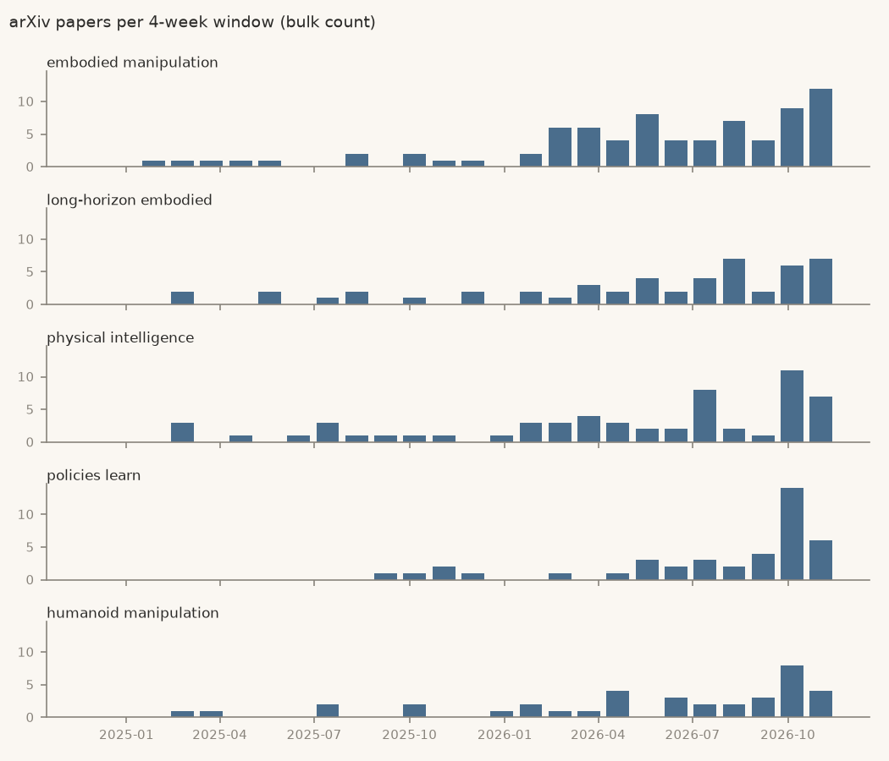

# Robotics brief, 16 Nov 2026

Week 4 of 4 of the trial. Robotics only (phrases from cs.RO titles).

> **Track record, read first.** In a backtest on robotics phrases new in 2024, **1 of 19 flagged topics (5%) took off within a year**. Picking at random would have found 6 of 491 (1%). It caught 1 of the 6 that took off. That failed the 50% bar set before testing. This trial runs on a bar lowered after seeing that result, so treat every flag below as roughly a 1-in-19 bet. [Details](../docs/BACKTEST.md#round-2-results)

## Study this next

<!-- pick:start -->
**Pick: physical intelligence, meaning robots that perceive, reason and act competently in the physical world.**

**What it is.** A broad label for embodied competence, used for anything from compliant walking to vision-language-action (VLA) policies and how to test them. It is also the name of a company whose π0.5 model appears in the benchmark below, so some repo hits may be about that company rather than the idea. ("policies learn", next down, is a fragment, so skipped.)

**Why now.** Score 2.24, the top early topic this week, outside recent picks. Against a year ago, papers are up 3.3× (relative to arXiv's own growth) and new repos 8.2× (raw GitHub count). There were 19 papers and 40 new repos in the last 12 weeks.

**What it rests on.**
- [VLA-MOPD](https://arxiv.org/abs/2611.12286): distils several task-specialist VLA policies into one student on its own rollouts; LIBERO mean success 75.4% to 98.9%.
- [RoboColosseum](https://arxiv.org/abs/2611.02497): 5,699 pairwise policy comparisons at 124 sites over four robot bodies; no policy completed any G1 humanoid task.

**What would prove it wrong.** Its 12-week paper count (bulk) never passes 76, four times today's 19, by 16 Nov 2027.

**First step, about 2 hours.** Work through [arXiv 2611.12286](https://arxiv.org/abs/2611.12286) with researcher-pal. By the end, explain how an instruction-routed frozen teacher supervises the student at each visited observation and intermediate flow-matching (ODE) state, and why that beats distilling only the final actions (98.9% against 98.15% on LIBERO). Reading only: the abstract links no code.
<!-- pick:end -->

## Opportunities to apply to

<!-- opportunities:start -->
- **Job:** [Research Engineer / Scientist, Reinforcement Learning, Harvey](https://jobs.ashbyhq.com/harvey/30df72cf-ee68-4194-864e-47745ca8b6e0). Rolling, remote (United States). Fits: owns the SFT and RL post-training recipe, builds reward functions and verifiers, and debugs "divergence, reward hacking, and instability" in training runs. Check: asks for hands-on RL post-training of LLMs with ownership of training runs; hiring across levels; the page states no degree, citizenship or visa terms, so ask. Checked 16 Nov 2026.
- **Job:** [Machine Learning Engineer Intern, Neuralink](https://job-boards.greenhouse.io/neuralink/jobs/6594261003). Rolling, South San Francisco, on-site. Fits: builds neural decoders for faster, more accurate brain-computer interface control of computers and robotic arms. Check: an internship; the form asks for graduation year, US work authorization and whether you need sponsorship; no degree is stated. Checked 16 Nov 2026.
- **Job:** [Brain-computer Interface Scientist, Noïa Labs](https://jobs.ashbyhq.com/noialabs/136a6845-6d54-4b5f-aaa9-b85c67e0229d). Rolling, Paris (hybrid). Fits: leads ML decoding of intent from non-invasive neural and physiological signals (EEG, EMG and others) across users and sessions. Check: it decodes intent, not movement specifically; requires 5+ years in ML or computational neuroscience; the page states no degree, citizenship or work-permit terms, so ask. Checked 16 Nov 2026.
<!-- opportunities:end -->

## Early / speculative

Confidence for every row: **low** (see the track record above). Score = weighted log₂ growth of papers and new repos (1 = doubling). Paper ratios are relative to arXiv's own growth; repo ratios are raw GitHub counts.

| Topic | Score | Why flagged | Papers, 12 wk | New repos, 12 wk | First flagged (window ending) |
|---|---|---|---|---|---|
| **embodied manipulation** | 2.73 | trend: papers 4.2×, new repos 13.0× vs a year ago | [25](https://arxiv.org/search/?query=%22embodied+manipulation%22&searchtype=all) | [12](https://github.com/search?q=%22embodied+manipulation%22+in%3Aname%2Cdescription+created%3A2026-08-24..2026-11-15&type=repositories) | 2026-06-01 |
| **long-horizon embodied** | 2.36 | trend: papers 5.2×, new repos 5.0× vs a year ago | [15](https://arxiv.org/search/?query=%22long-horizon+embodied%22&searchtype=all) | [9](https://github.com/search?q=%22long-horizon+embodied%22+in%3Aname%2Cdescription+created%3A2026-08-24..2026-11-15&type=repositories) | 2026-10-19 |
| **physical intelligence** | 2.24 | trend: papers 3.3×, new repos 8.2× vs a year ago | [19](https://arxiv.org/search/?query=%22physical+intelligence%22&searchtype=all) | [40](https://github.com/search?q=%22physical+intelligence%22+in%3Aname%2Cdescription+created%3A2026-08-24..2026-11-15&type=repositories) | 2026-04-06 |
| **policies learn** | 2.22 | trend: papers 3.3×, new repos 8.0× vs a year ago | [24](https://arxiv.org/search/?query=%22policies+learn%22&searchtype=all) | [7](https://github.com/search?q=%22policies+learn%22+in%3Aname%2Cdescription+created%3A2026-08-24..2026-11-15&type=repositories) | 2026-10-19 |
| **humanoid manipulation** | 2.20 | trend: papers 3.5×, new repos 7.0× vs a year ago | [15](https://arxiv.org/search/?query=%22humanoid+manipulation%22&searchtype=all) | [13](https://github.com/search?q=%22humanoid+manipulation%22+in%3Aname%2Cdescription+created%3A2026-08-24..2026-11-15&type=repositories) | 2026-10-19 |

## Consensus is moving

Heating up with 30 or more papers in 12 weeks: no longer early.

| Topic | Score | Why flagged | Papers, 12 wk | New repos, 12 wk | First flagged (window ending) |
|---|---|---|---|---|---|
| **video world** | 4.82 | trend: papers 35.8×, new repos 19.8× vs a year ago | [54](https://arxiv.org/search/?query=%22video+world%22&searchtype=all) | [78](https://github.com/search?q=%22video+world%22+in%3Aname%2Cdescription+created%3A2026-08-24..2026-11-15&type=repositories) | 2025-12-15 |
| **robot foundation** | 4.03 | trend: papers 21.5×, new repos 10.8× vs a year ago | [32](https://arxiv.org/search/?query=%22robot+foundation%22&searchtype=all) | [42](https://github.com/search?q=%22robot+foundation%22+in%3Aname%2Cdescription+created%3A2026-08-24..2026-11-15&type=repositories) | 2026-08-24 |
| **latent world** | 3.91 | trend: papers 12.9×, new repos 19.0× vs a year ago | [98](https://arxiv.org/search/?query=%22latent+world%22&searchtype=all) | [75](https://github.com/search?q=%22latent+world%22+in%3Aname%2Cdescription+created%3A2026-08-24..2026-11-15&type=repositories) | 2026-02-09 |
| **action chunks** | 3.30 | trend: papers 9.6×, new repos 10.1× vs a year ago | [117](https://arxiv.org/search/?query=%22action+chunks%22&searchtype=all) | [70](https://github.com/search?q=%22action+chunks%22+in%3Aname%2Cdescription+created%3A2026-08-24..2026-11-15&type=repositories) | 2025-12-15 |
| **physical ai** | 3.18 | trend: papers 4.2×, new repos 28.2× vs a year ago | [51](https://arxiv.org/search/?query=%22physical+ai%22&searchtype=all) | [1383](https://github.com/search?q=%22physical+ai%22+in%3Aname%2Cdescription+created%3A2026-08-24..2026-11-15&type=repositories) | 2025-07-28 |

## Not covered in this trial

Tools rising and fading, companies heating up, AI tooling and the wider field. Across all four categories the method scored about random in the backtest (on held-out phrases, 1 of 14 flagged topics took off, 7%, against 6% at random), so this trial leaves them out rather than print flags known to be noise.

## How this was made

- Candidates: 579 two- and three-word phrases in cs.RO titles in 2025 that were rare in the two years before (`bleedingedge/mining.py`). Mined by rule, not picked.
- Paper counts: arXiv bulk metadata (cs.RO, cs.LG, cs.AI, cs.CL; title or abstract) to 15 Nov 2026. The linked arXiv searches count differently (the bulk count is about 0.6× arXiv search); they are there to read the papers. The newest days are thin because arXiv announces papers a day or two late.
- New repos: GitHub repository search on name and description, linked per row.
- Thresholds are invented starting points, unchanged from the backtest. Every row is in `data/Trends.csv`.
- No buy, sell or hold advice, ever.
