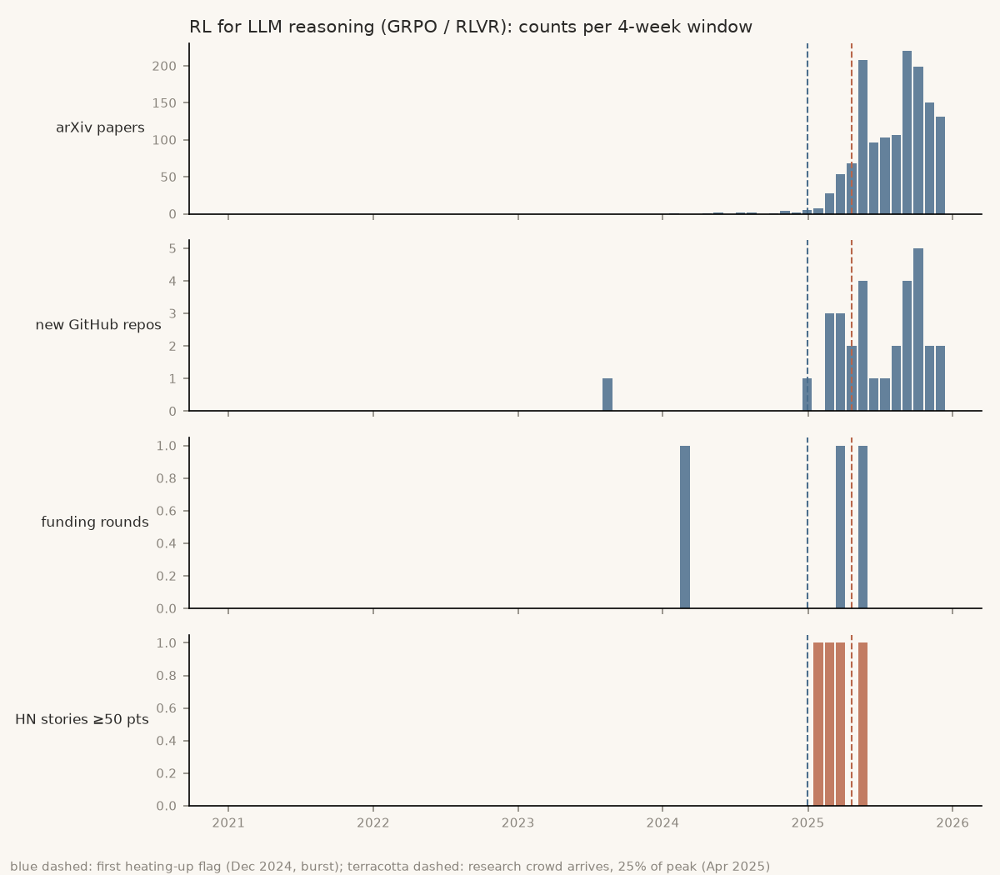
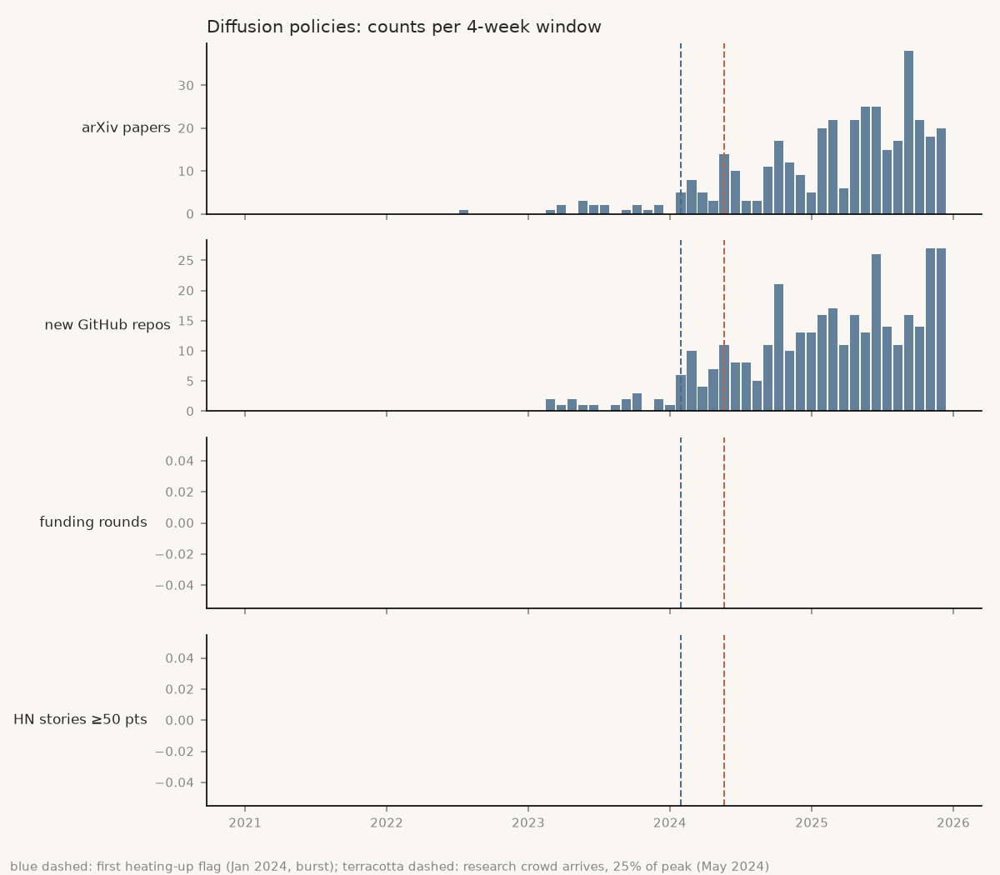

# Backtest: would the method have spotted past trends early?

**Verdict: both criteria now pass on the dev half, but only just, and only after tuning on it. The held-out half decides. Don't run the weekly brief until it has.**

- Criterion (a) passes, but it's in-sample, so it's weak evidence.
- Criterion (b) was 6%, then 0 of 3, then 41%. With the final two fixes it's **52% (15 of 29)**, just over the 50% bar. arXiv-only scored 30%.
  - **Treat 52% as in-sample:** I chose the fixes after seeing the 41%.
  - **One hit fewer and it fails:** 14 of 29 is 48%.
  - **Counted by distinct topic, it's 40%:** 4 of 10.
- See [the final fixes](#final-fixes-relative-growth-and-a-calibrated-small-bar). The held-out half (36 topics) is still sealed. It's the only clean test left.

Run on 2026-10-26 over Jan 2021 – Dec 2025: 65 four-week windows, 3 test topics, 59 candidate topics. The signals were arXiv, new GitHub repos and funding rounds. Citations and lab papers were left out because they wait on API keys. Every count, query URL and chart is in [BacktestResults.md](BacktestResults.md), which is generated. Raw counts are in `data/backtest/Counts.csv`.

## The question

If this detector had run every 4 weeks from 2021, would it have flagged the topics you later wished you'd studied, and would it have done so ≥ 8 weeks before the research crowd arrived?

- **Hypothesis.** Growth in leading signals (papers, new repos, funding), measured both as a sudden burst and as a year-over-year trend, flags a topic before it's crowded.
- **Baseline.** The same detector using arXiv only. If more signals don't beat it, they're not worth collecting.
- **"The crowd arrives".** This is the first window where a topic's 12-week paper count reaches 25% of its eventual peak. It uses hindsight, so it only grades the method and is never fed into it.
- **Metrics.** The spec sets the pass criteria:
  - **(a) Lead.** At least 2 of the 3 test topics are flagged ≥ 8 weeks early.
  - **(b) Precision.** Take the top 10 "early" flags in each 2024 window. At least 50% of them should have the crowd arrive within the next 12 months.

## (a) Lead on the test topics: passes, but in-sample

| Topic | First flag | Crowd arrives | Lead | arXiv-only lead |
|---|---|---|---|---|
| GRPO / RLVR | 30 Dec 2024 (trend) | 21 Apr 2025 | 16 wk | 16 wk |
| Diffusion policies | 29 Jan 2024 (burst) | 20 May 2024 | 16 wk | 16 wk |
| VLAs | 17 Jun 2024 (trend) | 19 May 2025 | 48 wk | 52 wk |

The spec asked for leads at 4, 8 and 12 weeks. All 3 topics pass at all three, because the shortest lead is 16 weeks.





**Why this is weak evidence:**

- **The method was redesigned after the first run, which used these same 3 topics.** That run missed VLAs, so I added the trend ratio, changed how consensus is defined and dropped acronyms. Passing on the topics you tuned against is like grading yourself on the practice exam.
- **The search phrases were picked in 2026.** "Vision-language-action" is the name the field settled on. Someone in 2023 might have searched a different term.
- **The arXiv-only baseline does just as well, and slightly better on VLAs.** On these topics, GitHub and funding add no lead. GitHub's lead weight is 0.67, but it never beats arXiv to the flag.

## (b) Precision on the candidates: fails

| Method | Flags in 2024 | Crowd arrived within 12 months | Precision |
|---|---|---|---|
| Full method (tuned weights) | 16 | 1 | 6% |
| Full method (untuned) | 16 | 1 | 6% |
| arXiv only | 77 | 1 | 1% |

The single hit was cross-embodiment learning. It was flagged in Sep 2024 and the crowd arrived in Oct 2024, which is a lead of only 4 weeks.

**Why it failed.** There are two reasons, and they need different fixes.

1. **The test could barely score a hit.** Using the arXiv counts, here is when each of the 59 candidates had its crowd arrive:

   | When the crowd arrived | Candidates |
   |---|---|
   | Never (fewer than 20 papers per 12 weeks at peak) | 29 |
   | 2021, the first year of data, meaning they were established before the window opened | 24 |
   | 2022–23 | 5 |
   | In 2024–25, the only years a 2024 flag could count | **1** |

   So even a perfect detector would have scored about 1 hit, because workshop titles name topics that are already active. The candidate list doesn't test the detector.

2. **The detector did flag the wrong things.** 7 of the 12 topics it flagged had their crowd arrive back in 2021. Examples are tactile sensing, legged locomotion and long-horizon planning. They count as "early" only because they stay small: fewer than 50 papers per 12 weeks. **The "early" rule measures size, not newness.** A small, mature topic with a noisy month looks the same as a new one. The test does get this part right, and it's a real flaw.

## Second run: 2023 candidates and a newness test

**What changed (2026-10-27):**

1. **"Early" now also means new.** A topic must have had fewer than 10 papers in the same 12 weeks two years earlier. The 10 is invented.
2. **New candidate list.** It holds every RL, robotics, agents and ML-tooling workshop at CoRL, RSS, ICRA, NeurIPS, ICML and ICLR 2023: 97 topics in [`data/Candidates2023.csv`](../data/Candidates2023.csv).
   - They were picked by an inclusion rule, not by me.
   - Search phrases are taken word for word from the 2023 titles and calls.
3. **Held-out half.** The list is split in half by a hash of each name:
   - **Dev half:** 40 topics, used here.
   - **Held-out half:** 57 topics. It has not been fetched, so nobody has seen it yet.
4. **Mature topics dropped from the score.** Candidates whose crowd arrived before 2023 are left out of (b).

**Dev-half result:**

| Method | Flags in 2024 | Crowd arrived within 12 months | Precision |
|---|---|---|---|
| Full method (tuned) | 3 | 0 | 0% |
| arXiv only | 15 | 0 | 0% |
| Full method, mature topics left in | 7 | 0 | 0% |

**The newness test worked.** On the old list it cut flags from 16 to 5, and no small mature topic was flagged this time.

**But the test still can't score a hit.** Here is how the 40 dev topics break down:

| How the topic did | Topics |
|---|---|
| Crowd never arrived (fewer than 20 papers per 12 weeks at peak) | 24 |
| Crowd arrived in 2021 | 14 |
| Crowd arrived in 2023 | 2 |
| Crowd arrived in 2024–25, the only years a 2024 flag could count | **0** |

Half of the dev topics peak below 10 papers per 12 weeks. Workshop wording ("variable impedance learning and control", "construction robotics") is too narrow to ever draw a crowd.

The 3 topics flagged were exactly these small niches, and none of them took off. They peaked at 18, 16 and 11 papers per 12 weeks. **So 0 of 3 is a true result, but it's 3 data points.**

**What this says.** Workshop lists are the wrong place to find candidates. A workshop gets organised either after a topic is established or around a niche. Both lists, 156 topics in total, contained only 1 topic whose crowd arrived in 2024–25. That one was cross-embodiment learning, from the first list. A detector can't show precision on a list with almost no positives.

## Third run: candidates mined from arXiv

**What changed (2026-10-27):**

1. **Nobody picks the candidates.** I downloaded metadata for every arXiv paper since 2021 in cs.RO, cs.LG, cs.AI and cs.CL: about 420,000 papers, CC0 licensed.
   - A **candidate** is a 2–3-word phrase that was in at least 8 titles in 2023, but in fewer than 10 papers (titles or abstracts) in 2021–22. Both cutoffs are invented.
   - Only data up to the end of 2023 chooses the candidates.
   - The code is [`bleedingedge/mining.py`](../bleedingedge/mining.py), and the list is [`data/CandidatesMined2023.csv`](../data/CandidatesMined2023.csv): 88 phrases.
2. **Counts come from the downloaded metadata.** For these candidates, arXiv counts come from the bulk download instead of the search API. GitHub and Hacker News are still searched online.
3. **Same hash split as before.** The dev half has 52 topics. The held-out half has 36 and is still sealed.

**Dev-half result:**

| Method | Flags in 2024 | Crowd arrived within 12 months | Precision | Topics flagged | Topics that hit |
|---|---|---|---|---|---|
| Full method (tuned) | 46 | 19 | **41%** | 12 | 4 |
| arXiv only | 117 | 27 | 23% | 20 | 4 |

"Flags" counts each topic once per 4-week window it was flagged in, so one topic can count several times.

**What it got right:**

- **The test can finally score hits.** 5 of the 52 dev topics had their crowd arrive in 2024–25.
- **It caught 4 of those 5:** flow matching, low-rank adaptation (LoRA), large vision-language models, and chain-of-thought reasoning. It missed "reasoning in language".
- **GitHub earns its place on this list.** Both methods caught the same 4 winners. The full method flagged about a third as many topic-windows (46 vs 117) and wasn't fooled by "AI act" or "latent diffusion". That's the first evidence that a second signal adds anything. On the 3 test topics, it added nothing.

**What it got wrong:**

- **Precision is 41%, below the 50% bar.** Most misses are one topic flagged many times. "Large multimodal models" was flagged in 10 windows, but its crowd had already arrived in Nov 2023.
  - The cause: "early" means fewer than 50 papers in 12 weeks. On these 4-category counts, 50 is generous. A topic can be crowded at 30 papers.
  - I haven't changed it. Tuning on the dev half after seeing it would spend its credibility.
- **Counted by distinct topic, precision is 33%.** 4 of the 12 flagged topics took off.

**Before trusting this, know that:**

- **This list is mostly LLM and generative-AI topics.** 80 of 88 candidates are tagged AI tooling and only 8 robotics. Robotics phrases rarely reach 8 titles a year. So this run tests the method on AI topics, not on your main domain.
- **cs.CV isn't in the download.** Diffusion and vision work mostly lives there, so some phrases ("latent diffusion") look newer than they are.
- **arXiv itself is growing.** It had about 30% more papers each year in these categories (39k in 2021, 91k in 2025). Every topic's growth ratio is inflated by that much. A fix would divide by total volume, but it isn't applied.
- **I adjusted the mining rules twice before this run.** That included keeping hyphenated words whole and dropping title boilerplate like "leveraging large language". I did it after reading the 2023 candidate list, but before looking at any 2024–25 outcome.

## Final fixes: relative growth and a calibrated "small" bar

These were decided 2026-10-27, before the held-out half was opened.

1. **Relative growth.** A topic's arXiv growth ratio is now divided by the same ratio for all harvested papers.
   - Without this, arXiv's own growth (about 30% a year in these categories) counted as every topic heating up.
   - Example: a topic that only keeps pace with arXiv now scores 1, not 1.3.
   - This applies to arXiv only. GitHub repos and funding are left as they were.
   - For the 3 test topics, arXiv counts come from search across all categories, but they're divided by the 4-category total. That's an approximation.
2. **"Small" bar calibrated to the downloaded counts.** The downloaded counts cover 4 categories and match whole words only, so they come out lower than arXiv search counts for the same phrase.
   - I checked 11 neutral phrases that are neither test topics nor candidates, such as "imitation learning" and "federated learning". The download counted a median of 0.61 of what search counts.
   - So "small" for mined topics is now fewer than 30 papers in 12 weeks (50 × 0.6). The test topics keep 50.
   - Calibration data: [`data/backtest/calibration/SmallBar.txt`](../data/backtest/calibration/SmallBar.txt).

**Each fix's effect on the dev half** (full method, tuned):

| Version | Precision | Flags | Topics that hit / flagged | arXiv-only precision |
|---|---|---|---|---|
| Third run (neither fix) | 41% | 46 | 4 / 12 | 23% |
| Relative growth only | 44% | 41 | 4 / 10 | 26% |
| Small bar only | 48% | 33 | 4 / 12 | 27% |
| **Both (final)** | **52%** | 29 | 4 / 10 | 30% |

Criterion (a) is unchanged at 16 / 16 / 48 weeks.

**What the fixes do:**

- **Both fixes only remove flags.** They catch no new winners: it's the same 4 of 5 either way.
- **Most of the removed flags were repeats.** "Large multimodal models" dropped from 10 flags to 5.
- **The remaining misses are topics whose crowd arrived in 2023:** large multimodal models, Segment Anything and AI-generated text. They were still under 30 papers per 12 weeks when flagged in 2024.

**How much to trust 52%:**

- **It's in-sample.** I picked these fixes after seeing the dev half.
- **The 29 flags aren't independent.** One topic is flagged in several windows.
- **The margin is one hit.** A rough 95% interval on 15 of 29 is 34–69%.

**The held-out half is the real test.** Open it once, with nothing changed in between:

```bash
uv run python -m bleedingedge.backtest --holdout
```

## Other findings

- **README search leaks hindsight.** When GitHub search included README text, 61 "VLA" repos showed up as created in 2021, before the term existed, because README text is what the repo says today. That gave VLAs a fake 96-week lead. GitHub now searches only names and descriptions. Run `--with-readme` to reproduce the comparison; results go to `data/backtest/WithReadme/`.
- **Hacker News can't mark consensus for RL/robotics.** No test topic ever had more than 1 story with ≥ 50 points in a 4-week window. Diffusion policies never got one at all. HN is still counted, but only for comparison.
- **Funding.** Funding scored a lead weight of 0.67 on 3 topics with 15 hand-collected rounds. Diffusion policies had none, so the weight is low-confidence.

## Limits

- The citation and lab-paper signals aren't in yet. They might add lead, and they're the most likely to do so for VLAs, since big labs drove that topic.
- arXiv phrase search matches loosely and only searches titles and abstracts. Counts may be off in either direction, though the error should be consistent across years.
- Deleted GitHub repos are missing. This biases older windows downward.
- 3 test topics is a very small sample. One topic changing its result moves (a) a lot.

## Next

1. **Open the held-out half once** (the command above).
   - **If precision ≥ 50% there:** the method passes, and the weekly brief is worth building.
   - **If it's below:** the method fails on clean data. The fallback is the simpler arXiv-growth script. On the dev half it scored 30%, so even that should be described honestly as "a list to skim", not "picks".
2. **Citations and lab papers aren't in.** If your keys arrive after the held-out run, adding them is a new method. It would need a new held-out set: for example, phrases new in 2024, graded on 2025–26.
3. **For your domain, run robotics separately.** Mine phrases from cs.RO alone, with a lower title bar and its own held-out half. This run was 90% AI/LLM topics.

## Reproduce

```bash
uv run python -m bleedingedge.sources.arxiv_bulk  # bulk arXiv metadata, ~2.5 h the first time, resumable
uv run python -m bleedingedge.mining              # mine candidates from it
uv run python -m bleedingedge.backtest            # dev half
uv run python -m bleedingedge.backtest --holdout  # held-out half: run once, at the end
```

The cached API responses in `data/cache/` make re-runs free and identical. Delete that folder to refetch.
