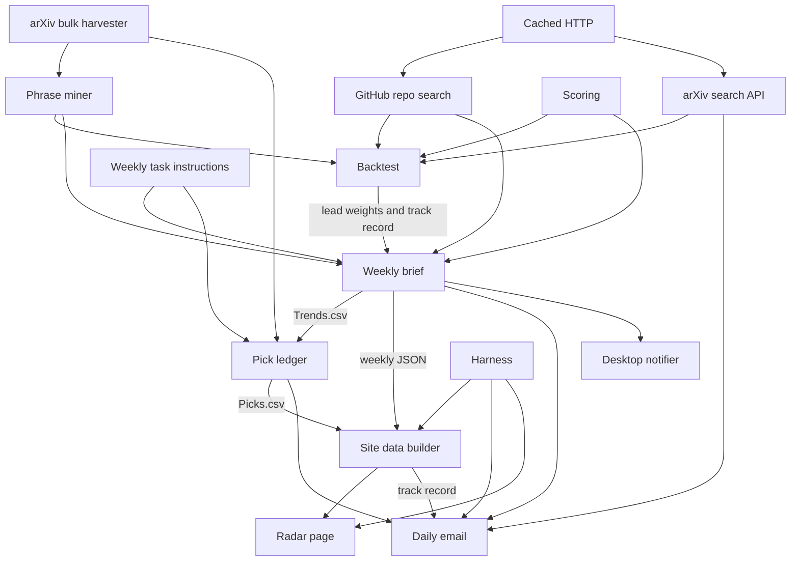
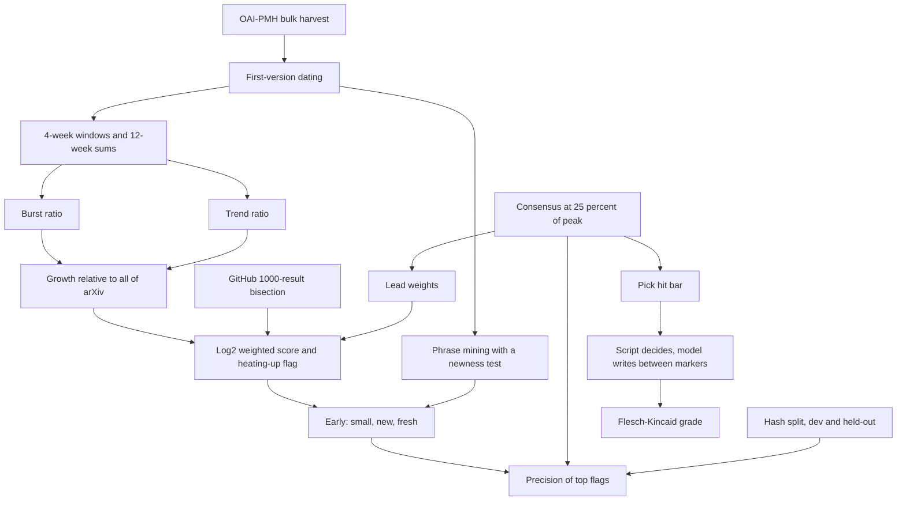

<!-- ProjectForge explainer at b7b8cf8 -->
# How BleedingEdge was built

BleedingEdge is a weekly robotics brief that names one topic to study next. Around it sit a pick ledger, a private website, a daily email and a daily improver. It is for one researcher who wants to be deep in a topic before it takes off. The core idea: flag a phrase that is still small and new, but whose papers (measured against arXiv's own growth) and new GitHub repos are both rising fast. Every flag is printed next to the backtest's honest record, which is about chance.

## Build history

```mermaid
flowchart LR
  idea["Idea: see where things are going, study topics before the crowd"]
  d1["Decided: change one decision, what to study next; speed of growth, not size"]
  d2["Decided: weekly brief first, numbers first, LLM optional; 4-week trial plus backtest"]
  d3["Decided: backtest Jan 2021 to Dec 2025; consensus is the research crowd; trend plus burst; drop bare acronyms; funding bonus only; public repo"]
  m1["Backtest and sources, 27 Oct 2026"]
  m2["Candidates mined from bulk arXiv, 27 Oct 2026"]
  m3["Backtest fails; dates fixed, 27 to 28 Oct 2026"]
  m4["Robotics trial starts, 28 to 31 Oct 2026"]
  d4["Decided: opportunities, fit and open now, short section, kill if no application in 8 weeks"]
  m5["Opportunities, notification, trial weeks 2 to 4, 2 to 16 Nov 2026"]
  m6["Picks graded, trial passes, 18 to 19 Nov 2026"]
  d5["Decided: 4 of 4 picks acted on, keep and add a site; private page; daily email only if new, via Gmail connector"]
  m7["Radar website and daily email, 19 Nov 2026"]
  d6["Decided: readers are friends, family, students; improver changes words and layout by PR; harness checks"]
  m8["Daily improver and first explainers, 19 Nov 2026"]
  idea --> d1 --> d2 --> d3 --> m1 --> m2 --> m3 --> m4 --> d4 --> m5 --> m6 --> d5 --> m7 --> d6 --> m8
```

- **Backtest and sources (27 Oct 2026).** The first commit added the backtest, data, docs and tests. The second backtest run added a newness test and 2023 workshop candidates. GitHub search now covers the whole span in one query and splits only past its cap. The repo was made public. Why: the "4-week trial + backtest" decision meant testing the method on past trends before trusting it.
- **Candidates mined from bulk arXiv (27 Oct 2026).** Added a resumable arXiv bulk harvester. Candidate topics are now phrases new on arXiv in 2023, so nobody picks them by hand. Hyphenated words stay whole. Boilerplate, years and fragments of old phrases are filtered out. arXiv growth is measured relative to all papers, and the "small" bar is scaled. Why: the precision check needed dated candidates from the time, duds included.
- **Backtest fails; dates fixed (27–28 Oct 2026).** On the held-out half, the precision check (b) failed at 41%. Round 2 used phrases new in 2024, graded on 2025–26, and failed at 23%. Papers were then dated by their first version, not their latest revision. The re-run gave robotics 1 of 19, about chance.
- **Robotics trial starts (28–31 Oct 2026).** Added the weekly robotics brief and the week 1 brief and study pick. A re-run keeps the pick already written. GitHub results marked incomplete are no longer cached. Added a shared shortcuts list. Corrected the brief's repo-ratio label and its all-categories result.
- **Opportunities, notification, trial weeks 2–4 (2–16 Nov 2026).** Each brief gained up to 3 opportunities to apply to. Added the Monday desktop notification and the missed-brief alert. Wrote the week 2, 3 and 4 briefs and picks, and updated the meta-instructions.
- **Picks graded, trial passes (18–19 Nov 2026).** Every Monday now reminds you that the trial review is due until it is filled in. Each pick is graded by script against the test its brief wrote down. Trial result: 4 of 4 picks acted on, so keep the brief.
- **Radar website and daily email (19 Nov 2026).** Added the BleedingEdge Radar site with its weekly update. Added the daily email: new papers, today's step and close deadlines. Then both were made easier to read. Older topics fold away, marks are explained, fragments are dropped, and overlapping chart labels were fixed.
- **Daily improver (19 Nov 2026).** Added the improver's harness, its rules and plain-language explainers. The first explainers covered the week's pick and two early topics. They arrived as pull request #1, which was merged.

## Code map

| Part | File | What it does |
|---|---|---|
| arXiv bulk harvester | `bleedingedge/sources/arxiv_bulk.py` | Downloads every cs.RO/LG/AI/CL paper since 2021 over OAI-PMH, tops it up weekly, and fixes each paper's date to its first version. |
| Cached HTTP | `bleedingedge/http.py` | GET with a disk cache keyed by URL, per-host delays and retries. Never caches GitHub results marked incomplete. |
| GitHub repo search | `bleedingedge/sources/github.py` | Creation dates of new repos whose name or description contains a phrase. Splits the date range while results pass 1,000. |
| arXiv search API | `bleedingedge/sources/arxiv.py` | Papers whose title or abstract contains a phrase, by submission date. |
| Hacker News, funding | `bleedingedge/sources/hackernews.py`, `bleedingedge/sources/funding.py` | Backtest-only signals: HN stories with 50+ points, and hand-collected funding rounds from `data/Funding.csv`. |
| Windows | `bleedingedge/windows.py` | Bins dates into 28-day windows. The backtest grid starts Monday 4 Jan 2021; the brief can shift the grid. |
| Phrase miner | `bleedingedge/mining.py` | Finds 2–3-word title phrases that are common in one year and rare in the two years before. |
| Scoring | `bleedingedge/scoring.py` | Pure functions: growth ratios, score, heating-up, early, consensus and lead weights. |
| Backtest | `bleedingedge/backtest.py` | Runs the method over 2021–26 history and measures lead time and precision on a dev half and a held-out half. |
| Backtest report | `bleedingedge/report.py`, `bleedingedge/calibrate.py` | Charts and tables for the backtest; calibrates bulk counts against arXiv search counts. |
| Weekly task instructions | `prompts/WeeklyBrief.md` | Step list the Monday scheduled task follows: run the brief, write the pick and opportunities, grade, update the site, notify. |
| Weekly brief | `bleedingedge/brief.py` | Scores this year's robotics candidates. Writes the brief draft, the chart, the weekly JSON and rows in `data/Trends.csv`. |
| Pick ledger | `bleedingedge/ledger.py` | Sets each pick's bar and due date, then grades it "took off", "didn't take off" or "open" in `data/Picks.csv`. |
| Site data builder | `bleedingedge/site.py` | Reshapes briefs, trends, picks and explainers into five JSON files for the page. |
| Radar page | `web/radar.html` | The private claude.ai dashboard page. It draws only from the site's JSON files. |
| Daily email | `bleedingedge/daily.py` | Decides whether anything is new today and writes the email to `site/email.json`; remembers papers once sent. |
| Desktop notifier | `bleedingedge/notify.py` | Monday macOS notification: the pick, new opportunities, a question about an unmarked pick, or an alert if the brief is missing. |
| Harness | `bleedingedge/harness.py` | Hard checks the improver's pull requests must pass: tests, page scripts, data, track record, hype words, explainers, reading level, privacy. |

## Concepts

**OAI-PMH bulk harvest** — OAI-PMH is a protocol libraries use to hand out metadata in pages. Each page ends with a "resumption token" that asks for the next one. The project needs it because asking arXiv's search API about hundreds of phrases would take hours, while one local copy answers any phrase instantly. `harvest` saves the token after every page, so a stopped harvest resumes. `update` tops the copy up each week, and `papers` removes duplicates. Lives in `bleedingedge/sources/arxiv_bulk.py`.

**First-version dating** — For revised papers (about 30% of records), the OAI feed gives the date of a later version. That put papers in the wrong month or year. An arXiv id such as `2611.12286` encodes the year and month of the first version (`2611` = Nov 2026), plus a sequence number given out in order through the month. `first_version` keeps the feed's date if it falls in that month or the next. Otherwise it estimates the day from the sequence number as a share of the month's largest one. Fixing this moved the round-2 robotics result to 1 of 19. Lives in `bleedingedge/sources/arxiv_bulk.py`.

**Phrase mining with a newness test** — A candidate topic is a 2–3-word phrase found in at least 8 titles in one year, with that bar scaled down for cs.RO alone (`ro_min_titles`). It must also appear in fewer than 10 papers (title or abstract) in the two years before. Phrases can't start or end with stop words or title boilerplate such as "leveraging". A 3-word phrase is dropped if either 2-word half was already common (100 or more papers). A shorter phrase is dropped if a longer candidate covers 80% of its titles. This gives a list of winners and duds that nobody chose with hindsight. Lives in `bleedingedge/mining.py`.

**4-week windows and 12-week sums** — Dates are binned into 28-day windows (`counts`). A "12-week" figure is the sum of the last 3 windows (`rolling`). The backtest grid starts Monday 4 Jan 2021 and has 75 windows. The weekly brief uses 40 windows that end on the run date, so each brief sees a fresh last window. Lives in `bleedingedge/windows.py`, `bleedingedge/scoring.py` and `bleedingedge/brief.py` (`grid`).

**Burst ratio** — This compares one window with the mean of the three before it. It catches sudden jumps. The +1 keeps zero counts from dividing by zero. It is undefined for the first 3 windows.

$$g^{\text{burst}}_k = \frac{c_k + 1}{\tfrac{1}{3}(c_{k-1}+c_{k-2}+c_{k-3}) + 1}$$

Lives in `bleedingedge/scoring.py` (`growth`).

**Trend ratio** — This compares the last 12 weeks with the same 12 weeks a year earlier (13 windows back). It was added because burst alone never flagged vision-language-action models: they grew about 8× a year, which shows up as only about 1.2× in any one window (`docs/SYSTEM-DESIGN.md`).

$$g^{\text{trend}}_k = \frac{R_k + 1}{R_{k-13} + 1}, \qquad R_k = c_k + c_{k-1} + c_{k-2}$$

Lives in `bleedingedge/scoring.py` (`trend`).

**Growth relative to all of arXiv** — arXiv in these four categories grew from 39k papers in 2021 to 91k in 2025. A raw ratio would call every topic "heating up". So each arXiv ratio is divided by the same ratio computed on all harvested papers. GitHub ratios stay raw. Lives in `bleedingedge/scoring.py` (`relative`), used in `bleedingedge/brief.py` and `bleedingedge/backtest.py` (`fetch`).

**GitHub 1000-result bisection** — GitHub search returns at most 1,000 results per query. `_range` makes one query for the whole span. If the total is over the cap, it splits the date range in half and recurses. Only full phrases are searched (`_full_phrases` drops bare acronyms like "GRPO", which matched about 100 unrelated repos a year before the method existed). Only names and descriptions are searched, because README text is today's and put 61 "VLA" repos in 2021. Lives in `bleedingedge/sources/github.py` and `bleedingedge/backtest.py`.

**Lead weights** — Each signal (arXiv, GitHub, funding) gets a weight λ. It is the share of the 3 test topics (diffusion policies, VLAs, GRPO/RLVR) where that signal crossed on its own at least 8 weeks (2 windows) before consensus. This makes signals that led in the past count for more. The robotics run that the brief uses gave arXiv 1.0, GitHub 0.667 and funding 0.667 (`data/backtest/Run2024RO/Summary.json`). Lives in `bleedingedge/scoring.py` (`signal_crossing`, `lead_weights`).

**Log2 weighted score and heating-up flag** — The score averages log₂ of each leading signal's ratio, weighted by λ. A score of 1 means the signals doubled on average. It is then scaled by a domain weight w (1.0 for robotics).

$$S_k = w \cdot \frac{\sum_s \lambda_s \log_2 g_{s,k}}{\sum_s \lambda_s}$$

A topic is "heating up" in a window if, in burst or trend mode, all three of these hold:
- S passes the threshold: 1 for burst, log₂3 ≈ 1.58 for trend.
- At least 2 signals rise: g ≥ 1.5 for burst, g ≥ 2 for trend.
- There is enough volume: for burst, 5+ papers or 10+ repos in the window; for trend, 10+ papers or 30+ repos in 12 weeks.

Funding is never averaged in. A round only adds a bonus of 0.5·λ, because rounds are rare and their zeros dragged every score down. Lives in `bleedingedge/scoring.py` (`score`, `heating_up`, `funding_bonus`) and `bleedingedge/backtest.py` (`flags`).

**Early: small, new, fresh** — A heating-up topic is "early" only if all three of these hold:
- **Small:** fewer than 50 papers in 12 weeks on arXiv search counts. For bulk counts the bar is 30, because `bleedingedge/calibrate.py` found bulk counts are a median 0.61× of arXiv search counts.
- **New:** fewer than 10 papers in the same 12 weeks two years earlier.
- **Fresh:** within 9 windows (36 weeks) of its first heating-up flag.

"Fresh" was added because topics that had plateaued kept getting flagged. All three use only past data. Lives in `bleedingedge/scoring.py` (`still_small`, `is_new`, `fresh`, `early`) and `bleedingedge/backtest.py` (`LOCAL_SMALL_MAX`).

**Consensus at 25 percent of peak** — Grading needs a date for "the crowd has arrived". It is the first window where a topic's 12-week arXiv count reaches 25% of its highest value over the whole backtest. A topic whose peak never reaches 20 never got a crowd. Hacker News was the first choice, but no test topic ever had more than 1 story with 50+ points in a window. This rule uses hindsight, so it only grades the method and never feeds a live flag. Lives in `bleedingedge/scoring.py` (`consensus_window`).

**Hash split, dev and held-out** — Candidates are split in half by the SHA-1 hash of their name. Normal runs see only the dev half. `--holdout` fetches the other half once, at the end. That way the method can't be tuned on the data that judges it. Lives in `bleedingedge/backtest.py` (`held_out`, `run`).

**Precision of top flags** — In each window of the judged year, the backtest takes the top 10 early flags by score. A flag is a hit if the topic's consensus arrives after the flag and within 13 windows (12 months). "Topic precision" is the number of distinct topics hit over the number flagged. The brief's "1 of 19" is this figure, summed over both halves of the robotics round-2 run. A baseline using arXiv growth alone runs through the same check. Lives in `bleedingedge/backtest.py` (`precision`) and `bleedingedge/brief.py` (`record`).

**Pick hit bar** — Each pick is graded against the backtest's own rule. Consensus means reaching 25% of the peak. So a flag was early only if the peak ends up more than 4× the count when picked. The floor of 20 matches the minimum peak for a crowd. Due date: one year after the pick.

$$\text{bar} = \max(20,\; 4 \cdot R_{\text{pick}})$$

`grade` computes a daily rolling 12-week count from the pick date to today or the due date, whichever is earlier. The status is "took off" once the peak passes the bar, and "didn't take off" if the due date passes first. Lives in `bleedingedge/ledger.py`.

**Script decides, model writes between markers** — Every number and every grade comes from a script. The scheduled Claude task writes only prose, between HTML comment markers (`<!-- pick:start -->` … `<!-- pick:end -->`, and the same for opportunities). It appends only date, topic and first step to `data/Picks.csv`. `keep_pick` carries the written sections over when a brief is re-run. The daily email works the same way: the script decides `send`, and the model only sends the email. This keeps the model from grading its own picks. Lives in `bleedingedge/brief.py`, `prompts/WeeklyBrief.md` and `bleedingedge/daily.py`.

**Flesch-Kincaid grade** — A formula that estimates the US school grade needed to read a text, from sentence length and syllables per word. The harness fails any explainer, or the page's help text, above grade 10, because the readers include friends, family and students. Syllables are counted as vowel groups, minus a silent final "e".

$$\text{grade} = 0.39\,\frac{\text{words}}{\text{sentences}} + 11.8\,\frac{\text{syllables}}{\text{words}} - 15.59$$

Lives in `bleedingedge/harness.py` (`grade`, `check_reading_level`).

## One input, start to finish

The phrase **"physical intelligence"** in the brief of Monday 16 Nov 2026.

1. **The weekly task starts.** `prompts/WeeklyBrief.md` step 2 runs `uv run python -m bleedingedge.brief`, which calls `main(date(2026, 11, 16))` in `bleedingedge/brief.py`.
2. **arXiv is topped up.** `arxiv_bulk.update` (`bleedingedge/sources/arxiv_bulk.py`) fetches records changed since the last update into `upd*.jsonl.gz` files. `arxiv_bulk.papers` merges them, removes duplicates by id, and resets each date with `first_version`.
3. **Candidates are mined.** `score_topics` calls `mining.mine(papers, 2025, ro=True, ...)` (`bleedingedge/mining.py`). "physical intelligence" qualifies: it recurs in 2025 cs.RO titles and was rare in 2023–24. It is one of 579 candidates that week.
4. **Papers are counted.** `brief.grid` builds 40 windows of 28 days ending on 16 Nov 2026. `mining.phrase_dates` finds every paper whose title or abstract contains the phrase. `windows.counts` bins those dates and also bins all papers as the baseline.
5. **arXiv growth is measured.** `scoring.growth` and `scoring.trend`, divided by the all-papers ratios through `scoring.relative`, give a burst ratio of 1.38 and a trend ratio of 3.26 at the last window. 3.26 ≥ 2, so the topic is worth a GitHub search.
6. **GitHub is searched.** `github.dates(["physical intelligence"], start, day)` (`bleedingedge/sources/github.py`) goes through `http.get_text`, which caches the response. Result: 40 new repos in 12 weeks, a trend ratio of 8.2 and a burst ratio of 0.98.
7. **The topic is scored and flagged.** `backtest.flags` (`bleedingedge/backtest.py`) uses the lead weights from `data/backtest/Run2024RO/Summary.json` (arXiv 1.0, GitHub 0.667). The trend score is (1.0·log₂3.26 + 0.667·log₂8.2) / 1.667 ≈ 2.24. It is heating up: 2.24 ≥ 1.58, both ratios are ≥ 2, and 19 papers in 12 weeks is ≥ 10. It is early on all three tests. Small: 19 < 30. New: few papers two years back. Fresh: first flagged in the window ending 6 Apr 2026, 8 windows earlier, within the 9-window limit.
8. **The shortlist is built.** `main` sorts by score. The early list is embodied manipulation 2.73, long-horizon embodied 2.36, physical intelligence 2.24, then "policies learn" and humanoid manipulation. `recent_picks` reads the last 3 picks from `data/Picks.csv`, and two of the top topics were among them. So the shortlist of 3 starts with physical intelligence, and the two repeats are listed as "left out". `examples` attaches the most recent matching papers.
9. **Files are written.** `render` and `keep_pick` write `briefs/2026-11-16.md` with an empty pick section. `chart` draws `briefs/img/2026-11-16.png`. `append_trends` writes this row to `data/Trends.csv`: 4-week count 7, 12-week count 19, score 2.236, heating True, early True. The weekly JSON goes to `data/briefs/2026-11-16.json`.
10. **The model writes the pick.** In step 3 of `prompts/WeeklyBrief.md`, the task picks physical intelligence and notes that "policies learn" is a fragment. Between the markers it writes the pick with its test: "never passes 76, four times today's 19, by 16 Nov 2027". The first step is a 2-hour read of arXiv 2611.12286. Step 4 appends `2026-11-16,physical intelligence,<url>` to `data/Picks.csv`.
11. **The ledger grades it.** `ledger.main` (`bleedingedge/ledger.py`) runs `fill`. That calls `papers_on`, which reads 19 from the Trends.csv row, sets the bar to max(20, 76) = 76, and sets the due date to 2027-11-16 with `a_year_after`. `grade` then walks each day with `count_12w`. As of 18 Nov 2026 it recorded a peak of 19 on 16 Nov, so the status is "open".
12. **The website is rebuilt.** Step 8b runs `site.write`, which calls `site.build` (`bleedingedge/site.py`). The topic gets status "Early" in `topics.json`, and its plain-language text comes from `data/Explainers.json`. Its 40-window history goes into `series.json`, its weekly scores into `scores.json`, and its ledger grade into `picks.json`. The task uploads the files, and `web/radar.html` draws from them.
13. **You are notified.** Step 10 runs `notify.main` (`bleedingedge/notify.py`). `message` finds the finished brief and the pick for that day. It sends "Pick: physical intelligence." plus the count of new opportunities through `osascript`.
14. **The daily email watches it.** At 7:30 each day, `daily.compose` (`bleedingedge/daily.py`) runs. `watched` puts the latest pick first, then the top early topics, skipping `data/Fragments.csv`. `new_papers` asks the arXiv API for matches submitted in the last 7 days that were not emailed before. `todays_step` reads `data/steps/<pick date>.json` on Tuesday to Friday. The 16 Nov brief came before the daily email existed, and no step file for it is in the repo, so that part stays empty. If anything is new, `send` is true; the task sends the email through Gmail, and `daily sent` (`mark_sent`) records the paper ids.
15. **The improver checks its explainer.** The "physical intelligence" entry in `data/Explainers.json` came in through pull request #1. Before it merged, `harness.check_explainers` checked each part: 25–90 words, no digits, https sources, and arXiv ids that exist. `check_no_hype` checked for hype words, and `check_reading_level` checked for grade 10 or below (`bleedingedge/harness.py`).

## Where this came from

Written from the spec, the decisions, the git history and the code as of commit b7b8cf8 (merge of PR #1, 19 Nov 2026).
