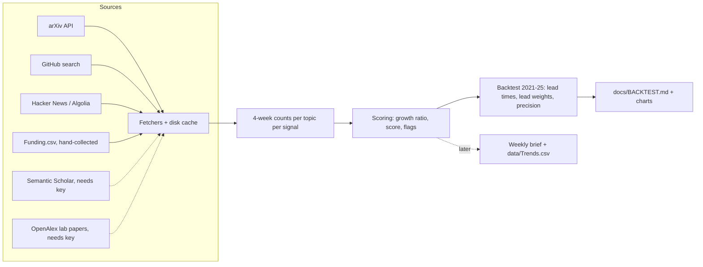

# BleedingEdge System Design

BleedingEdge is a weekly, cited brief that picks one topic to study next. Before any weekly
brief runs, a backtest checks whether the method would have spotted past trends early.
This doc covers both. Only the backtest is built so far.

## The whole build, in order

1. **Backtest** (built; failed (b) on 2026-10-26, see BACKTEST.md): fetch 2021–25 history, score it, measure the lead over the
   consensus signal, set each signal's lead weight, write `docs/BACKTEST.md`.
2. **Weekly brief** (only if the backtest passes): `prompts/WeeklyBrief.md` run by a Claude
   scheduled task. It reuses the same fetchers and scoring for the last 16 weeks and
   appends to `data/Trends.csv`.
3. **4-week trial review**, then tuning weights to your picks.

The fetchers and scoring are the parts the weekly brief will reuse. That's why they're a small
package rather than a single throwaway script.

## Components

| Piece | Job | Interface |
|---|---|---|
| `bleedingedge/windows.py` | Splits 2021–25 into 4-week windows that start on Mondays | `windows()`, `window_index(date)` |
| `bleedingedge/http.py` | GET with a disk cache, polite per-host delays, retries on 429/5xx | `get_text(url)`, `get_json(url)` |
| `bleedingedge/mining.py` | Mines candidate phrases new in 2023 from the bulk arXiv metadata | `python -m bleedingedge.mining` |
| `bleedingedge/sources/*.py` | One module per source. Each returns the dates of matching items | `dates(phrases, start, end) -> list[date]` |
| `bleedingedge/scoring.py` | Growth ratio, score, heating-up and consensus flags, lead weights | pure functions, no I/O |
| `bleedingedge/backtest.py` | Loads topics, fetches, scores, measures leads and precision | `python -m bleedingedge.backtest` |
| `bleedingedge/report.py` | Writes `docs/BacktestResults.md` and the charts (`docs/BACKTEST.md` is written by hand from them) | `write_report(results)` |

Each source returns **item dates, not counts**. One paginated query per phrase gets every
matching item in the window, and binning happens locally. For example, arXiv gets one query per
phrase instead of one per window: about 3 calls instead of 65.

## Data

- `data/TestTopics.csv`: the three test topics and their search phrases (chosen now, a known
  source of hindsight).
- `data/CandidatesMined2023.csv`: precision-check topics mined from 2023 arXiv titles by `bleedingedge/mining.py`
  (phrases new in 2023), with local arXiv counts in `data/backtest/MinedArxivCounts.json`. Split by hash into
  dev and held-out halves.
- `data/cache/arxiv_bulk/`: bulk arXiv metadata since 2021 (cs.RO/LG/AI/CL), from OAI-PMH, ~200 MB gzipped.
- `data/Candidates2023.csv`: earlier precision-check topics, every relevant 2023 workshop at CoRL/RSS/ICRA/NeurIPS/ICML/ICLR,
  split by hash into a dev half and a held-out half (`--holdout`, run once). The earlier 2022–24 list is
  `data/Candidates2022-24.csv`. Each row cites its source URL.
- `data/Funding.csv`: announced rounds, each with a source URL.
- `data/cache/`: raw API responses, keyed by URL. Re-running is free and gives the same result.
  Delete the folder to refetch.
- `data/backtest/`: computed counts and flags as CSV.
- Secrets: `.env` (never committed) holds `S2_API_KEY`, `OPENALEX_API_KEY`. GitHub uses
  your existing `gh` login.

## Key decisions and trade-offs

- **4-week windows, two growth ratios.** Burst = this window vs the 3 before; trend = the last
  12 weeks vs the same 12 weeks a year earlier. The first run used burst only, and it never
  flagged VLAs: they grew about 8× a year, which shows up as only about 1.2× in any one window.
- **Item dates, cached on disk.** This keeps runs reproducible and keeps API use within free limits.
  The trade-off: the cache goes stale, so you delete it to refresh.
- **GitHub = new repos per window, searched by name and description for full phrases.** Stars
  of chosen repos would need hindsight to choose them. README search was dropped after a check:
  README text is today's, and it put 61 "VLA" repos in 2021, before the term existed. That made
  GitHub look 48 weeks earlier than arXiv on VLAs. Bare acronyms ("GRPO") were dropped because
  they match unrelated repos. Run `--with-readme` to reproduce the comparison.
- **Consensus = the research crowd arrives (grading only).** This is the first window where the
  12-week arXiv count reaches 25% of its peak. HN was the first choice, but no test topic ever
  had more than 1 story with ≥50 points in a window. The crowd date uses hindsight, so it only
  grades the method; the detector's own "early" test (fewer than 50 papers in 12 weeks, and fewer than 10 two years earlier) uses
  only past data.
- **arXiv growth is relative to all papers.** arXiv grew ~30% a year in these categories (39k papers in
  2021, 91k in 2025), so a raw ratio calls every topic "heating up". Totals come from the bulk download.
- **"Small" depends on how papers were counted.** The bulk download counts ~0.6× what arXiv search does for
  the same phrase (`bleedingedge/calibrate.py`), so mined topics use 30 papers per 12 weeks, not 50.
- **Funding adds a bonus, never a drag.** Rounds are rare, so averaging their zeros pulled every
  score toward "no change".
- **Stdlib HTTP, matplotlib for charts, pytest.** Boring, proven tools, with few dependencies.

## Testing

- `tests/test_scoring.py`: the growth ratio and score against the spec's worked example
  (12 vs 6 papers → g ≈ 4.33), plus flags, leads and lead weights on small synthetic series:
  normal, flat, zero-count, never-crosses.
- `tests/test_sources.py`: each parser runs on a saved real response in `tests/fixtures/`, with
  no network, including empty results and pagination.
- `tests/test_windows.py`: window edges and dates outside the range.

Run: `uv run pytest`.

## Known limits

- Search phrases for the test topics were chosen in 2026, knowing how things turned out.
- The method was redesigned after seeing the 3 test topics (trend ratio, new consensus), so
  criterion (a) is in-sample. The precision check on the 59 workshop candidates is the
  out-of-sample test.
- arXiv's phrase search matches tokens loosely and doesn't search the full text.
- Funding is a small hand-collected sample.
- Citation and lab signals wait on API keys.

## What changes with scale

At ~50 topics the backtest makes a few hundred cached calls, which is fine. The weekly brief
covers ~40 topics × 6 signals, also fine. Past ~500 topics, GitHub's 30-searches-a-minute limit
and arXiv's 3-second delay mean a run takes hours. At that point, switch to the arXiv bulk
metadata (OAI-PMH) and GH Archive, and store counts in SQLite instead of CSV.
